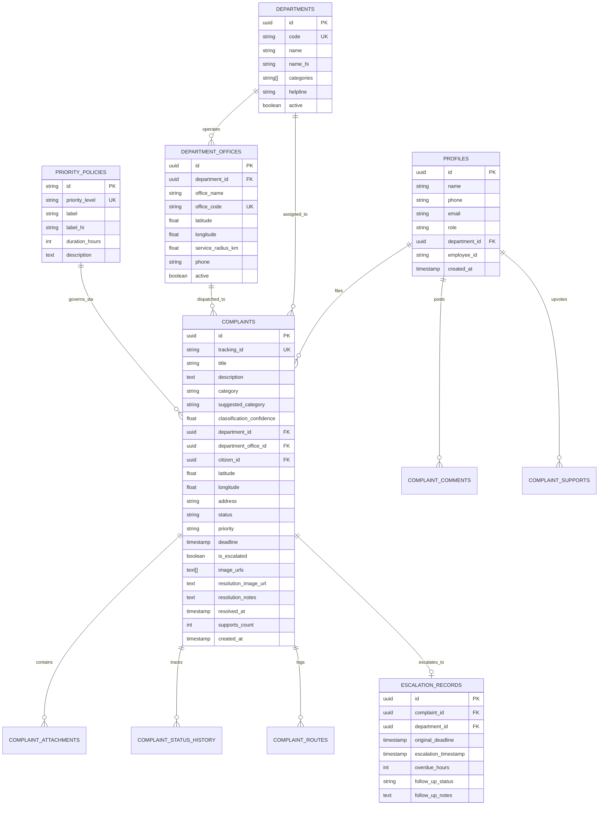

# Database Design & Entity Architecture

## 1. Relational Entity Relationship Diagram

---

## 2. Table Specifications & Indexing Strategy

| Table Name | Primary Key | Key Indexes | Purpose |
|---|---|---|---|
| `profiles` | `id (UUID)` | `role`, `department_id` | Stores citizen, staff, and admin identities with department assignments. |
| `departments` | `id (UUID)` | `code` (Unique) | Municipal departments master list (PWD, Waste, Water, etc.). |
| `department_offices` | `id (UUID)` | `(latitude, longitude)`, `office_code` | Ward division offices with GPS coordinates for spatial dispatch. |
| `complaints` | `id (UUID)` | `status`, `category`, `department_id`, `deadline`, `(latitude, longitude)`, `tracking_id` | Core grievance master table with SLA deadlines and resolution states. |
| `complaint_attachments` | `id (UUID)` | `complaint_id`, `attachment_type` | Controlled photo evidence and resolution proof records. |
| `complaint_status_history`| `id (UUID)` | `complaint_id`, `created_at` | Immutable audit trail recording every state change, actor, and timestamp. |
| `complaint_supports` | `id (UUID)` | Unique `(complaint_id, user_id)` | Enforces strict 1-upvote-per-user constraint to prevent ballot stuffing. |
| `escalation_records` | `id (UUID)` | Unique `complaint_id` | Guarantees idempotent escalation tracking with no duplicate records. |
| `priority_policies` | `id (String)` | `priority_level` (Unique) | Stores configurable SLA hours (Intermediate: 24h, Moderate: 72h, Standard: 168h). |

---

## 3. Row Level Security (RLS) Policy Architecture

All PostgreSQL tables are safeguarded with strict RLS policies defined in `supabase/migrations/20261023000000_init_fixmycity.sql`:
- **Public Read Access:** Public community feed and tracking routes can read complaint titles, categories, addresses, and status history. Sensitive citizen phone numbers are excluded from public select queries.
- **Citizen Inserts:** Authenticated citizens can insert complaints and comments.
- **Departmental Employee Updates:** Employees can only update complaints where `complaints.department_id = profiles.department_id`.
- **Administrative Access:** Administrators have system-wide override privileges for escalations and department directory configurations.
